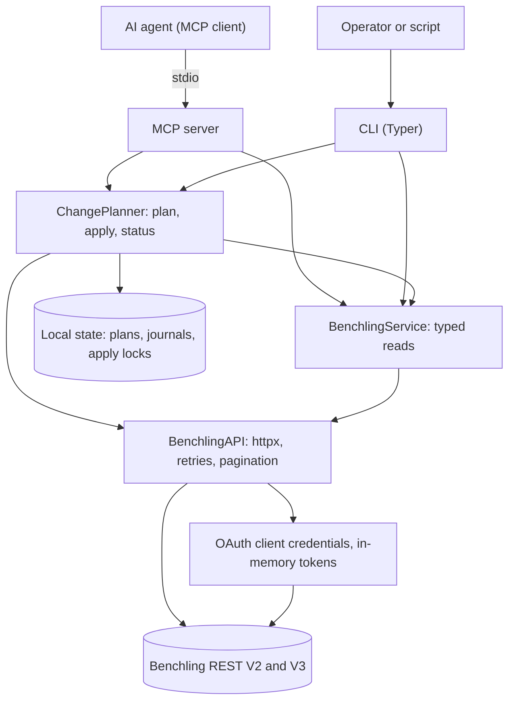

# benchling-agent

[](https://github.com/jmamodeo/benchling-cli/actions/workflows/ci.yml)
[](LICENSE)
[](pyproject.toml)
[](https://github.com/jmamodeo/benchling-cli/actions/workflows/ci.yml)

> **Unofficial; not affiliated with or endorsed by Benchling, Inc.** Benchling is a trademark of Benchling, Inc.

## Why this exists

An electronic lab notebook is a scientific record, so letting an AI agent write to one directly is hard to trust. `benchling-agent` puts a narrow, auditable layer between an agent and a [Benchling](https://www.benchling.com) tenant. Every change is first previewed as an immutable, checksummed plan that records what will change and the version preconditions it depends on. A separate, explicit step applies it: that step re-checks the preconditions, refuses stale or already-used plans, and records each stage in a local execution journal. The same typed service layer backs a JSON-first CLI and a local [Model Context Protocol](https://modelcontextprotocol.io) (MCP) server, and the MCP server cannot apply writes unless an operator opts a specific environment in with `--allow-writes`.

- Public Benchling API only; it never automates the browser.
- Four change families: document text, unstructured tables, entry fields, and assay results.
- Several environments at once, configured through environment variables only.
- One versioned JSON envelope and stable exit codes for both interfaces.

## Demo

This is the real output of the CLI and MCP server running against the offline fake Benchling API that the test suite uses; no credentials or network are involved. Reproduce it with `uv run python scripts/demo.py`. Long fields are trimmed for readability and plan IDs differ on every run.

```console
# 1. Read an entry (envelope trimmed for readability)

$ benchling --env demo entry inspect etr_abc123
{
  "ok": true,
  "data": {
    "version_id": "ver_1",
    "project_id": "src_abc123"
  }
}
[exit 0]

# 2. Preview: reads Benchling, writes nothing remotely

$ benchling --env demo changes plan --entry etr_abc123 --family table --spec set-cell-b2.json
{
  "ok": true,
  "data": {
    "id": "61f30b3982634235b8811a15e3ef3004",
    "family": "table",
    "env": "demo",
    "preconditions": {
      "table_version": "tver_1",
      "entry_id": "etr_abc123"
    },
    "guarantees": [
      "server-enforced document version check",
      "complete table replacement"
    ],
    "warnings": [
      "API table edits clear evaluated values until Benchling evaluates the table in the browser"
    ]
  }
}
[exit 0]

remote writes so far: 0

# 3. Apply the first plan

$ benchling --env demo changes apply 61f30b3982634235b8811a15e3ef3004
{
  "ok": true,
  "data": {
    "journal": {
      "status": "succeeded",
      "events": [
        {
          "stage": "apply",
          "status": "started"
        },
        {
          "stage": "replace_table",
          "status": "succeeded"
        },
        {
          "stage": "apply",
          "status": "succeeded"
        }
      ]
    }
  }
}
[exit 0]

# 4. The second plan was previewed against the old table version: apply is refused

$ benchling --env demo changes apply 346151df5d53417cb39d840ecb0c53f8
{
  "ok": false,
  "error": {
    "code": "conflict",
    "message": "Table version changed after the plan was created",
    "retryable": false,
    "details": {
      "expected": "tver_1",
      "actual": "tver_2"
    }
  }
}
[exit 5]

# 5. A plan cannot be applied twice

$ benchling --env demo changes apply 61f30b3982634235b8811a15e3ef3004
{
  "ok": false,
  "error": {
    "code": "conflict",
    "message": "Plan has already been applied or attempted",
    "retryable": false,
    "details": {
      "plan_id": "61f30b3982634235b8811a15e3ef3004",
      "status": "succeeded"
    }
  }
}
[exit 5]

remote writes in total: 1

# 6. MCP server: read-only unless --allow-writes ENV is passed

apply_changes(env="demo", plan_id=...) ->
{
  "code": "unsupported_capability",
  "message": "MCP writes are disabled for demo; restart with `benchling mcp serve --allow-writes demo`",
  "retryable": false,
  "details": {}
}
```

## Install

The package is not published to PyPI; install from source with [`uv`](https://docs.astral.sh/uv/) and Python 3.11 or newer.

```console
git clone https://github.com/jmamodeo/benchling-cli.git
cd benchling-cli
uv sync
uv run benchling --help
```

Examples below omit the `uv run` prefix; use it, or activate `.venv`, when running them. Add `--extra dev` to `uv sync` to install the test and lint tools.

## Configuration

Each environment is configured by three variables named `BENCHLING_<ENV>_*`. Any number of environments may be set at once:

```console
export BENCHLING_DEV_API_ENDPOINT="https://your-tenant-dev.benchling.com/"
export BENCHLING_DEV_CLIENT_ID="your-app-client-id"
export BENCHLING_DEV_CLIENT_SECRET="your-app-client-secret"
export BENCHLING_TEST_API_ENDPOINT="https://your-tenant-test.benchling.com/"
export BENCHLING_TEST_CLIENT_ID="your-app-client-id"
export BENCHLING_TEST_CLIENT_SECRET="your-app-client-secret"
```

The application uses OAuth `client_credentials` against `/oauth/token`, acting as the **app**, with the app's permissions and audit identity—not the signed-in browser user. The app must already have access to the entry's project. Tokens remain in process memory, cached per environment, and are renewed before expiry in a long-running MCP process. Nothing is saved to disk or the OS keychain, and profiles saved by previous versions are never read. Missing or partial variables produce an explicit authentication error; there is no fallback.

Environment names are the lowercase `<ENV>` part (letters and digits only). The environment is required on every command; there is no default:

```console
benchling envs list
benchling --env dev auth status
benchling --env test doctor
```

`auth status` checks local configuration only; `doctor` makes read-only API checks. `-e` is short for `--env`. To disconnect, unset the environment's variables in the calling shell and restart any MCP process; this does not revoke the app remotely.

`.env.example` contains the layout with placeholders. The CLI does **not** automatically load `.env` files: provide environment variables through your shell or MCP client's environment configuration. Never commit actual secrets or include them in command examples. Rotate any secret exposed in chat or logs before using it long-term.

HTTPS uses the operating system's certificate trust store, with certificate-chain and hostname verification enabled. No insecure TLS fallback is available.

## Quickstart

```console
export BENCHLING_DEV_API_ENDPOINT="https://your-tenant-dev.benchling.com/"
export BENCHLING_DEV_CLIENT_ID="your-app-client-id"
export BENCHLING_DEV_CLIENT_SECRET="your-app-client-secret"

benchling envs list
benchling --env dev doctor
benchling --env dev entry resolve EXP-0001
```

## CLI examples

### Read entries

Every command prints a versioned JSON envelope. Diagnostics go to stderr.

```console
benchling --env dev entry resolve EXP-0001
benchling --env dev entry get etr_abc123 --full
benchling --env dev entry inspect etr_abc123
benchling --env dev section get etr_abc123 docpart_section1
benchling --env dev part get etr_abc123 docpart_text1
benchling --env dev table get docpart_table1
benchling --env dev schema get entsch_example
benchling --env dev entry fields get etr_abc123
benchling --env dev results list --entry etr_abc123
benchling --env dev results tables etr_abc123
```

Entry references may be canonical IDs, display IDs, or URLs for the selected tenant. Duplicate section titles must be addressed by part ID.

### Preview and apply changes

A change specification covers one entry and one mutation family. Previewing only reads Benchling and creates a local immutable plan:

```console
benchling --env dev changes plan \
  --entry etr_abc123 \
  --family table \
  --spec examples/table-set-cells.json

benchling --env dev changes apply PLAN_ID
benchling --env dev changes status PLAN_ID
```

Supported specifications are documented in [schemas/change-spec.schema.json](schemas/change-spec.schema.json). The four families are:

- `document`: insert, delete, move, or replace a text part;
- `table`: set selected cells, append rows, or replace an unstructured table;
- `fields`: update fields already present on the entry's assigned schema; and
- `results`: submit V2 assay result records to an explicit `strtbl_…` table.

Field inputs must use a schema field's V3 `systemName` or its field-definition ID and have the shape `{"value": ...}`. Plans normalize IDs to system names, validate value types and constraints, and re-check the affected definitions and values immediately before applying. Result plans also verify that the table belongs to the selected entry, that every record uses the table's result schema, and that any supplied project IDs are readable.

Result submissions remain pending until a person integrates them in Benchling. A table write sends a complete version-checked table replacement and clears evaluated values until Benchling's browser evaluates it again.
Table upload plans use local correlation UUIDs; the tenant assigns the actual result IDs. Local UUIDs are not idempotency keys. Caller-supplied result IDs are rejected by the CLI because the tested tenant rejects them on this endpoint despite the public OpenAPI declaration. Notebook table uploads are limited to 500 records. The immediate apply result is `submission_pending`; task success is reported separately as `pending_integration`.
`changes status` checks Benchling's asynchronous task endpoint after a result submission while retaining the local execution journal as the reconciliation record.

## MCP server

Configure an MCP client to inherit the `BENCHLING_<ENV>_*` variables for every environment the agent may use (or supply them through the client's secure environment configuration). One server serves all configured environments:

```json
{
  "mcpServers": {
    "benchling": {
      "command": "benchling",
      "args": ["mcp", "serve"]
    }
  }
}
```

Every tool except `list_environments` takes a required `env` argument, and each call is authenticated with that environment's credentials. The server is read-only by default. To permit `apply_changes` in specific environments, add `--allow-writes ENV` after `serve` (repeatable, e.g. `--allow-writes dev --allow-writes test`); reads remain available in all environments. A plan can only be applied or checked in the environment that created it. `plan_changes` remains available because it performs remote reads and writes only an immutable local preview. Large entry, section, table, result, and schema responses expose offset/limit or cursor pagination and never silently truncate data.

The CLI and MCP tools share the same versioned envelope. Static schemas for the envelope and change specifications live under [`schemas/`](schemas/); MCP also publishes the generated input and output schema for each typed tool during tool discovery.

## Architecture



| Module (`src/benchling_agent`) | Role |
|---|---|
| `cli.py` | Typer command-line interface |
| `mcp_server.py` | MCP tools, read-only default, write allow-list |
| `services.py` | Typed read services and entry snapshots |
| `plans/planner.py` | `ChangePlanner`: plan, apply (under a per-plan file lock), status, journal |
| `plans/document.py`, `plans/table.py`, `plans/fields.py`, `plans/results.py` | One planning/apply mixin per change family |
| `plans/repository.py` | Plan and journal persistence, checksums, JSON diff |
| `api.py` | HTTP client for Benchling REST V2/V3: retries for reads, never for writes |
| `auth.py` | OAuth client-credentials token handling |
| `environment.py`, `config.py`, `runtime.py` | Environment discovery, state directories, per-environment runtimes |
| `models.py`, `errors.py` | Envelope, plan and journal models, error types and exit codes |
| `tls.py` | OS trust-store TLS |

## Safety model

- **Preview, then apply.** `changes plan` only reads Benchling and writes an immutable local plan; nothing changes remotely until `changes apply`.
- **Plans are checksummed and scoped.** A plan stores a SHA-256 of its content, verified on load, and is bound to the environment and tenant that created it. The checksum catches accidental corruption; it is not a signature and does not defend against someone who can already write to your state directory.
- **Version preconditions.** Document edits and table replacements send the version observed at preview time, and Benchling answers HTTP 409 if it is stale; table plans also re-check the table version just before writing. A concurrent edit becomes a conflict instead of an overwrite. Entry field updates have no atomic server-side precondition, so the affected values are compared immediately before writing; this is best effort.
- **Single use.** A plan with any prior attempt cannot be applied again, and a per-plan file lock stops a CLI and an MCP process from applying the same plan concurrently on one machine.
- **Writes are never retried.** A write that times out or fails with a server error leaves the journal in `unknown`/`partial` state for a person to reconcile; reads are retried with bounded backoff.
- **Read-only MCP by default.** `apply_changes` is refused unless the server was started with `--allow-writes ENV` for that environment. `plan_changes` stays available because it only reads Benchling and writes a local preview.
- **Explicit environment on every call.** There is no default environment, so a command or tool call cannot reach a tenant by omission.
- **Credentials stay in memory.** Environment variables only; no files, no keychain, error details never echo secrets, and TLS verification uses the OS trust store with no insecure fallback.

## Design decisions and tradeoffs

- **Plan/apply instead of one-call edit tools.** An agent reviews a concrete diff before anything is written, and replays are impossible. The cost is an extra step and some local state to manage.
- **Environment variables only, no default environment.** Nothing sensitive is stored and the target tenant is always explicit. The cost is verbosity and no keychain convenience.
- **App identity, not user identity.** OAuth client credentials give the agent its own permissions and audit identity, separate from any person's. The app must be granted access to each project it touches.
- **One service layer, two interfaces.** The CLI and MCP server call the same typed services and return the same envelope, so behavior is specified and tested once. The cost is a more verbose, JSON-first CLI.
- **Honest handling of API limits.** Benchling's document API cannot edit table cells individually, so table edits send a complete replacement that preserves supported cell fields; evaluated values are cleared. Replacing text is an insert followed by a delete and can end in a reported partial completion.
- **Local, single-machine state.** Plans, journals and locks are plain files under the application directory (`BENCHLING_AGENT_HOME` overrides it). That keeps the tool dependency-free but means concurrency control does not extend across machines.
- **Offline tests against a stateful fake.** The suite runs the real client, services and planner against an in-process fake Benchling API instead of stubbing each call. This tests behavior end to end; the cost is that the fake can drift from the real API, which is why the opt-in sandbox exercise exists.

## JSON envelope and exit codes

Every command and MCP tool returns `{"schema_version": "1.0", "ok": ..., "data": ..., "error": ..., "meta": ...}`. Exit codes:

| Code | Meaning |
|---:|---|
| 0 | Success |
| 2 | Input or validation error |
| 3 | Authentication error |
| 4 | Access denied or resource not found |
| 5 | Concurrent modification or reused plan |
| 6 | Unsupported capability |
| 7 | Upstream or transport failure |
| 8 | Partial or unknown write completion |

## Testing

The test suite is fully offline and needs no credentials. It runs the real client, services, planner, CLI and MCP server against a stateful in-process fake of the Benchling API (`tests/fake_benchling.py`).

```console
uv sync --extra dev
uv run ruff format --check .
uv run ruff check .
uv run mypy
uv run pytest --cov
```

The suite has 199 test functions (357 collected cases, parametrization included) and reaches 98% branch coverage. CI enforces a `fail_under` floor of 96% in `pyproject.toml`, and also builds the sdist and wheel, runs `twine check`, and smoke-tests the built wheel.

### Opt-in sandbox exercise

Offline tests never require credentials. After configuring a sandbox entry that you control, the interactive exercise below creates a plan, pauses for a browser edit to invalidate it, verifies the conflict, and then applies and verifies one selected-cell update. Add `--restore` to preview and explicitly restore the original input afterward.

```console
uv run python scripts/sandbox_exercise.py \
  --env dev \
  --entry etr_REPLACE_ME \
  --table-part docpart_REPLACE_ME \
  --row 0 --column 1 \
  --value cli-sandbox-check \
  --restore
```

## Known limitations

- **`replace_text` on flattened V3 text parts is verified against fixtures only.** The fix in 0.1.2 that lets `replace_text` accept the flattened `DocumentPartText` shape was built and tested against synthetic fixtures. It has not been verified against a live Benchling tenant, so do not rely on it for production data until it has been checked there (`scripts/live_cli_session.py` and `scripts/sandbox_exercise.py` are provided for that).
- The V3 Document API is in beta and Benchling may change it.
- Table edits clear evaluated values until Benchling recalculates them in the browser, and only unstructured tables are editable.
- Entry field updates are protected by a best-effort value comparison, not an atomic precondition.
- Replacing text can end in a partial completion that a person must reconcile.
- Assay result submissions stay pending until a person integrates them in Benchling.
- State is local to one machine and the package is not published on PyPI.
- The offline suite uses a synthetic fake; it cannot prove compatibility with every tenant configuration.

See [API limitations](docs/api-limitations.md) and the [research record](docs/research.md) before enabling writes against production data.

## Citation

If you use this software, please cite it. GitHub's "Cite this repository" button uses [`CITATION.cff`](CITATION.cff).

## Contributing, security, license

- [Contributing guide](CONTRIBUTING.md) and [Code of Conduct](CODE_OF_CONDUCT.md)
- [Security policy](SECURITY.md)
- [Changelog](CHANGELOG.md)
- Licensed under the [MIT License](LICENSE).
