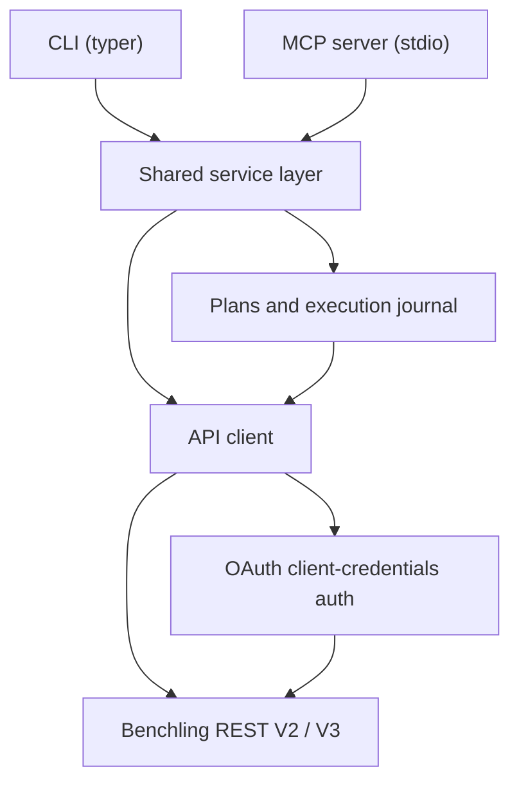

# benchling-agent

[](https://github.com/jmamodeo/benchling-cli/actions/workflows/ci.yml)
[](LICENSE)
[](pyproject.toml)
[](https://github.com/jmamodeo/benchling-cli/actions/workflows/ci.yml)

An agent-friendly `benchling` command-line tool and local MCP server for safely reading and editing Benchling notebook entries through the public API.

> **Unofficial; not affiliated with or endorsed by Benchling, Inc.** Benchling is a trademark of Benchling, Inc.

## Features

- One typed service layer exposed as both a JSON-first CLI and a local [Model Context Protocol](https://modelcontextprotocol.io) server (stdio).
- Public-API only; never automates the Benchling browser.
- Preview-then-apply writes with version preconditions and a local execution journal.
- Four change families: document, table, fields, and assay results.
- Multiple environments at once, configured purely through environment variables.
- Read-only MCP server by default; writes are enabled per environment.
- Versioned JSON envelope and stable exit codes.

## Install

The package is not on PyPI yet; install from source. Python 3.11+ and [`uv`](https://docs.astral.sh/uv/) are recommended.

```console
git clone https://github.com/jmamodeo/benchling-cli.git
cd benchling-cli
uv sync --extra dev
uv run benchling --help
```

Or with pip:

```console
python -m venv .venv
. .venv/bin/activate
python -m pip install -e '.[dev]'
```

## Configuration

Each environment is configured by three variables named `BENCHLING_<ENV>_*`. Any number of environments may be set at once:

```console
export BENCHLING_DEV_API_ENDPOINT="https://your-tenant-dev.benchling.com/"
export BENCHLING_DEV_CLIENT_ID="your-app-client-id"
export BENCHLING_DEV_CLIENT_SECRET="your-app-client-secret"
export BENCHLING_TEST_API_ENDPOINT="https://your-tenant-test.benchling.com/"
export BENCHLING_TEST_CLIENT_ID="your-app-client-id"
export BENCHLING_TEST_CLIENT_SECRET="your-app-client-secret"
```

The application uses OAuth `client_credentials` against `/oauth/token`, acting as the **app**, with the app's permissions and audit identity—not the signed-in browser user. The app must already have access to the entry's project. Tokens remain in process memory, cached per environment, and are renewed before expiry in a long-running MCP process. Nothing is saved to disk or the OS keychain, and profiles saved by previous versions are never read. Missing or partial variables produce an explicit authentication error; there is no fallback.

Environment names are the lowercase `<ENV>` part (letters and digits only). The environment is required on every command; there is no default:

```console
benchling envs list
benchling --env dev auth status
benchling --env test doctor
```

`auth status` checks local configuration only; `doctor` makes read-only API checks. `-e` is short for `--env`; `--profile`/`-p` remain accepted aliases. `login` and `logout` only print an explanatory message. To disconnect, unset the environment's variables in the calling shell and restart any MCP process; this does not revoke the app remotely.

`.env.example` contains the layout with placeholders. The CLI does **not** automatically load `.env` files: provide environment variables through your shell or MCP client's environment configuration. Never commit actual secrets or include them in command examples. Rotate any secret exposed in chat or logs before using it long-term.

HTTPS uses the operating system's certificate trust store, with certificate-chain and hostname verification enabled. No insecure TLS fallback is available.

## Quickstart

```console
export BENCHLING_DEV_API_ENDPOINT="https://your-tenant-dev.benchling.com/"
export BENCHLING_DEV_CLIENT_ID="your-app-client-id"
export BENCHLING_DEV_CLIENT_SECRET="your-app-client-secret"

uv run benchling envs list
uv run benchling --env dev doctor
uv run benchling --env dev entry resolve EXP-0001
```

## CLI examples

### Read entries

Every command prints a versioned JSON envelope. Diagnostics go to stderr.

```console
benchling --env dev entry resolve EXP-0001
benchling --env dev entry get etr_abc123 --full
benchling --env dev entry inspect etr_abc123
benchling --env dev section get etr_abc123 docpart_section1
benchling --env dev part get etr_abc123 docpart_text1
benchling --env dev table get docpart_table1
benchling --env dev schema get entsch_example
benchling --env dev entry fields get etr_abc123
benchling --env dev results list --entry etr_abc123
benchling --env dev results tables etr_abc123
```

Entry references may be canonical IDs, display IDs, or URLs for the selected tenant. Duplicate section titles must be addressed by part ID.

### Preview and apply changes

A change specification covers one entry and one mutation family. Previewing only reads Benchling and creates a local immutable plan:

```console
benchling --env dev changes plan \
  --entry etr_abc123 \
  --family table \
  --spec examples/table-set-cells.json

benchling --env dev changes apply PLAN_ID
benchling --env dev changes status PLAN_ID
```

Supported specifications are documented in [schemas/change-spec.schema.json](schemas/change-spec.schema.json). The four families are:

- `document`: insert, delete, move, or replace a text part;
- `table`: set selected cells, append rows, or replace an unstructured table;
- `fields`: update fields already present on the entry's assigned schema; and
- `results`: submit V2 assay result records to an explicit `strtbl_…` table.

Field inputs must use a schema field's V3 `systemName` or its field-definition ID and have the shape `{"value": ...}`. Plans normalize IDs to system names, validate value types and constraints, and re-check the affected definitions and values immediately before applying. Result plans also verify that the table belongs to the selected entry, that every record uses the table's result schema, and that any supplied project IDs are readable.

Result submissions remain pending until a person integrates them in Benchling. A table write sends a complete version-checked table replacement and clears evaluated values until Benchling's browser evaluates it again.
Table upload plans use local correlation UUIDs; the tenant assigns the actual result IDs. Local UUIDs are not idempotency keys. Caller-supplied result IDs are rejected by the CLI because the tested tenant rejects them on this endpoint despite the public OpenAPI declaration. Notebook table uploads are limited to 500 records. The immediate apply result is `submission_pending`; task success is reported separately as `pending_integration`.
`changes status` checks Benchling's asynchronous task endpoint after a result submission while retaining the local execution journal as the reconciliation record.

## MCP server

Configure an MCP client to inherit the `BENCHLING_<ENV>_*` variables for every environment the agent may use (or supply them through the client's secure environment configuration). One server serves all configured environments:

```json
{
  "mcpServers": {
    "benchling": {
      "command": "benchling",
      "args": ["mcp", "serve"]
    }
  }
}
```

Every tool except `list_environments` takes a required `env` argument, and each call is authenticated with that environment's credentials. The server is read-only by default. To permit `apply_changes` in specific environments, add `--allow-writes ENV` after `serve` (repeatable, e.g. `--allow-writes dev --allow-writes test`); reads remain available in all environments. A plan can only be applied or checked in the environment that created it. `plan_changes` remains available because it performs remote reads and writes only an immutable local preview. Large entry, section, table, result, and schema responses expose offset/limit or cursor pagination and never silently truncate data.

The CLI and MCP tools share the same versioned envelope. Static schemas for the envelope and change specifications live under [`schemas/`](schemas/); MCP also publishes the generated input and output schema for each typed tool during tool discovery.

## Architecture



| Module (`src/benchling_agent`) | Role |
|---|---|
| `cli.py` | Typer command-line interface |
| `mcp_server.py` | MCP tools, read-only default, write allow-list |
| `services.py` | Shared typed service layer |
| `plans/` | Immutable change plans, apply, status, journal (package, see below) |
| `plans/repository.py` | Plan and journal persistence, checksums, JSON diff helpers |
| `plans/base.py`, `plans/planner.py` | Shared planner core; `ChangePlanner` plan/apply/status and family dispatch |
| `plans/document.py`, `plans/table.py`, `plans/fields.py`, `plans/results.py` | One mixin per change family (document, table, fields, results) |
| `api.py` | HTTP client for Benchling REST V2/V3 |
| `auth.py` | OAuth client-credentials token handling |
| `config.py`, `environment.py`, `runtime.py` | Environment discovery and per-environment runtimes |
| `models.py`, `errors.py` | Envelope, models, and error types |
| `tls.py` | OS trust-store TLS |

## Safety model

- **Preview-then-apply:** `changes plan` only reads Benchling and writes an immutable local plan; nothing changes remotely until `changes apply`.
- **Version preconditions:** the entry version observed at preview time is preserved on apply, and affected values are re-checked immediately beforehand. A concurrent edit yields a conflict instead of an overwrite.
- **Single use:** a plan cannot be applied twice, and only in the environment that created it.
- **Read-only MCP by default:** `apply_changes` requires an explicit `--allow-writes ENV`.
- **Credentials stay in memory:** environment variables only; no files, no keychain, no insecure TLS fallback.

## JSON envelope and exit codes

Every command and MCP tool returns `{"schema_version": "1.0", "ok": ..., "data": ..., "error": ..., "meta": ...}`. Exit codes:

| Code | Meaning |
|---:|---|
| 0 | Success |
| 2 | Input or validation error |
| 3 | Authentication error |
| 4 | Access denied or resource not found |
| 5 | Concurrent modification or reused plan |
| 6 | Unsupported capability |
| 7 | Upstream or transport failure |
| 8 | Partial or unknown write completion |

## Testing

The test suite is fully offline and needs no credentials.

```console
uv sync --extra dev
uv run ruff check .
uv run mypy
uv run pytest --cov
```

The suite has 42 test functions (49 collected cases, parametrization included). Coverage is measured with branch coverage and enforced by a `fail_under` floor in `pyproject.toml`.

### Opt-in sandbox exercise

Offline tests never require credentials. After configuring a sandbox entry that you control, the interactive exercise below creates a plan, pauses for a browser edit to invalidate it, verifies the conflict, and then applies and verifies one selected-cell update. Add `--restore` to preview and explicitly restore the original input afterward.

```console
uv run python scripts/sandbox_exercise.py \
  --profile dev \
  --entry etr_REPLACE_ME \
  --table-part docpart_REPLACE_ME \
  --row 0 --column 1 \
  --value cli-sandbox-check \
  --restore
```

## Limitations

See [API limitations](docs/api-limitations.md) and the [research record](docs/research.md) before enabling writes against production data.

## Contributing, security, license

- [Contributing guide](CONTRIBUTING.md) and [Code of Conduct](CODE_OF_CONDUCT.md)
- [Security policy](SECURITY.md)
- [Changelog](CHANGELOG.md)
- Licensed under the [MIT License](LICENSE).
